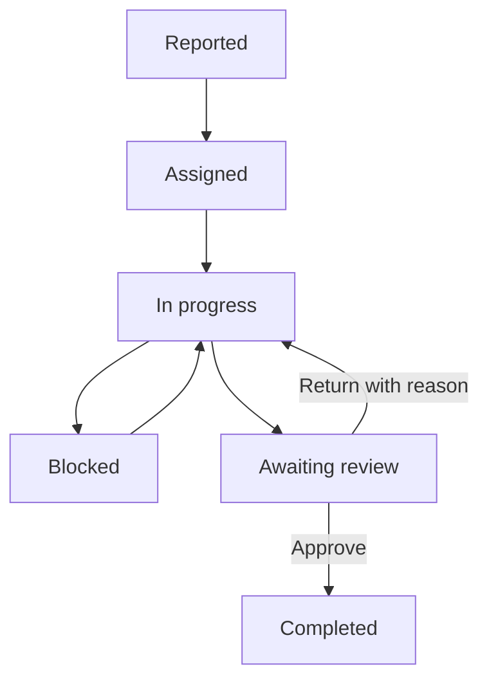

# MaintenanceFlow — especificación y guía de implementación para Codex

**Versión:** 1.1 (revisión crítica de la v1.0; ver sección 0.2)  
**Fecha de preparación:** 20 de noviembre de 2026  
**Contexto:** ejercicio de construcción de una aplicación full-stack sobre DeepSpace, con una ventana de cinco días.  
**Idioma del documento y de las explicaciones al desarrollador:** español.  
**Idioma inicial de la interfaz, nombres de código y documentación para evaluadores:** inglés.  
**Estado real de esta entrega:** especificación. Este documento no acredita que exista código, repositorio, pruebas ejecutadas o despliegue.  
**Fecha límite de entrega:** [completar con el dato real de la convocatoria; no inventarla].

> Codex: utiliza este archivo como contexto de producto y contrato de aceptación. Contrasta los detalles de plataforma con la versión instalada de DeepSpace antes de escribir código. Los nombres de acciones y tipos de dominio propuestos aquí pertenecen a MaintenanceFlow; no son APIs que debas asumir que exporta el SDK.

**Para empezar:** leer la sección 0 (invariantes y cambios de la v1.1), las secciones 1 a 6 para entender el producto, 8 a 14 para las decisiones técnicas y 18 a 21 para ejecutar y comprobar el trabajo. La sección 25 contiene los prompts para continuar en Codex; la 26 reúne las fuentes oficiales y la 27 un `AGENTS.md` sugerido.

## 0. Invariantes y cambios de la v1.1

### 0.1 Invariantes no negociables

1. Toda escritura de dominio pasa por una acción de MaintenanceFlow validada en el servidor; no existe una vía genérica `collection + recordId + patch`.
2. Identidad y rol de negocio salen del runtime y de una fuente del servidor, nunca del body, de un formulario ni de una variable local.
3. Estado y versión se comprueban en el mismo punto que confirma la escritura; si la plataforma no lo permite, la limitación se declara.
4. La evidencia de cierre es una fotografía **de reparación** subida por el técnico asignado durante el trabajo; la foto del reporte no la sustituye.
5. En `awaiting_review` la evidencia está congelada: lo que el supervisor aprueba es lo que vio.
6. Las fotos son privadas y se sirven solo mediante una pasarela autenticada de la app.
7. Los recibos de idempotencia no viajan a los clientes ni engordan el registro de la orden.
8. El sandbox tiene cuotas por usuario, porque cualquier cuenta autenticada puede escribir y el propietario paga el almacenamiento.
9. El proxy genérico de integraciones, las rutas de depuración y cualquier adaptador que exponga acciones (HTTP, MCP, WebMCP) no deben saltarse la autorización de dominio.
10. El código se despliega desde un árbol limpio de un repositorio ya publicado; el primer despliegue fija de forma permanente la autoridad del código.
11. No se marca como probado lo que no se ejecutó, ni se atribuye al candidato una verificación que solo hizo el agente.
12. Se pueden estudiar patrones de proyectos ajenos; no se copia su código.

### 0.2 Qué cambió respecto a la v1.0 y por qué

| Cambio | Motivo |
| --- | --- |
| Fotos `report` y `repair`; solo `repair` cuenta para enviar a revisión (3.1, 6, 7.3, 9.5, A27) | En la v1.0 la foto adjuntada al reportar bastaba para cumplir «al menos una foto», lo que vaciaba la propuesta de valor del cierre con evidencia |
| El técnico puede añadir ítems de checklist pero no borrar los del supervisor (7.3, A28) | La v1.0 permitía vaciar el checklist o dejaba un bloqueo si el supervisor no lo preparaba |
| Reasignación desde `in_progress` y `blocked` (6, A29) | Con un técnico ausente, la única salida era cancelar |
| Evidencia congelada en revisión y aprobación con versión vista (6, A31) | Evitar que cambie algo entre el envío y la aprobación |
| `recentOperations` sale de la orden hacia `operation_receipts` (9.3, 9.7) | La orden se reenvía completa a todos los suscriptores: filtraba huellas y operaciones ajenas y engordaba cada actualización |
| Unicidad de intención por actor + `operationId` (9.4, 9.5, 12.3) | Un `operationId` global permite colisiones y sondeo entre usuarios |
| Cuotas anti-abuso y aviso de metadatos EXIF (4.1, 13) | Un sandbox abierto a cualquier cuenta no tenía límites de costo ni de abuso |
| Límite de tres fotos y subidas simultáneas dentro de la sección serializada (13, A30) | Dos subidas a la vez podían superar el límite |
| Personas demo marcadas para el seed (17) | La v1.0 pedía órdenes asignadas sin técnico existente y prohibía inventar identidades |
| Cómo obtienen las pruebas un supervisor y un técnico (18, día 1) | El supervisor es el propietario; las cuentas de prueba del SDK no lo son. La v1.0 no resolvía esto |
| Primer despliegue el día 1 y árbol limpio (18, 20) | La v1.0 dejaba la verificación del entorno final para el día 5 |
| Latching de la autoridad de código descrito (20) | Un remoto equivocado en el primer deploy exige crear otra app |
| Adaptadores de acciones, `ALLOW_DEBUG_ROUTES`, proxy bloqueado, `uniqueOn`, escrituras confirmadas (10, 12, 21) | Nombrar primitivas y riesgos concretos que las notas de versión y proyectos similares muestran, para contrastarlos con el SDK instalado |
| Orden de recorte dentro de P0 y punto de control del día 3 (3.1.1, 18) | La v1.0 solo decía qué recortar fuera de P0 |
| Cola «Needs your action» por rol y controles deshabilitados con razón (16) | Mejora el valor inmediato para cada rol y para un evaluador con rol operador |
| Anexo A con `AGENTS.md` sugerido (27) | Dar al agente los invariantes en un archivo corto que siempre lee |

### 0.3 Alcance de la revisión de la v1.1

Esta revisión comparó el documento con notas de versión públicas del SDK y con READMEs de proyectos similares, pero no pudo abrir `docs.deep.space`. Las primitivas que aquí se nombran (`uniqueOn`, `userBound`, escrituras confirmadas, adaptadores de acciones, comportamiento del latching) proceden de esas fuentes y se marcan «comprobar»; la versión instalada del SDK manda. La mejora no sustituye la prueba de día 1.

## 1. Qué vamos a construir

MaintenanceFlow coordina el mantenimiento de equipos mediante un flujo verificable: una persona reporta una falla, un supervisor asigna el trabajo, un técnico documenta la intervención y el supervisor aprueba o devuelve el cierre.

**Descripción breve en inglés:**

> MaintenanceFlow helps a small maintenance team report equipment issues, assign work, document repairs, and approve completion in one shared, real-time workspace.

La diferencia respecto a un tablero genérico es el cierre respaldado por evidencia: una orden está vinculada a un equipo, tiene responsable, checklist, fotografías e historial, y distingue entre terminar el trabajo y aprobarlo.

La primera versión debe demostrar criterio técnico con un recorrido completo. No se busca construir un CMMS empresarial ni una herramienta de diagnóstico automático de maquinaria.

### Resultado demostrable

En dos sesiones independientes, un cambio aceptado en el servidor debe aparecer en la otra sesión sin recargar. Un operador no puede asignar técnicos ni aprobar órdenes, aunque intente llamar directamente a la API. Un técnico no puede cerrar una orden que necesita revisión del supervisor.

### Escenario conductor

1. El operador detecta una fuga en el equipo ficticio `PUMP-003`.
2. Crea una orden y adjunta una fotografía de demostración.
3. El supervisor ve la orden en su bandeja y asigna un técnico.
4. El técnico inicia el trabajo, documenta lo realizado, completa el checklist y sube una fotografía de la reparación.
5. Envía la orden a revisión.
6. El supervisor verifica la evidencia y aprueba el cierre.
7. Las sesiones muestran el mismo resultado y el historial conserva quién hizo cada cambio.

## 2. Contexto de la evaluación

El ejercicio solicita una aplicación interactiva full-stack construida y desplegada en DeepSpace, un repositorio y una nota breve sobre integraciones, decisiones, uso del agente y verificación personal del candidato.

| Lo que se quiere demostrar | Evidencia prevista en MaintenanceFlow |
| --- | --- |
| Alcance razonable para cinco días | Un espacio compartido, un flujo de órdenes y tres roles de negocio |
| Comprensión de DeepSpace | Autenticación, colecciones, permisos, suscripciones y despliegue reales |
| Profundidad técnica | Transiciones autorizadas, evidencia de cierre y manejo de concurrencia |
| Integraciones con propósito | Archivos para evidencia; IA opcional para redactar un borrador |
| Código comprensible | Reglas de dominio separadas de componentes y adaptadores del SDK |
| Dirección y revisión del agente | Registro de decisiones, pruebas y correcciones del candidato |
| Honestidad sobre límites | Diferenciar lo implementado, lo probado y lo pendiente |

El texto de la convocatoria compartido por el candidato es la referencia para los requisitos de entrega. No atribuirle exigencias adicionales como una cantidad mínima de integraciones, pagos o inteligencia artificial.

## 3. Decisiones de alcance

### 3.1 P0 — versión que debe terminarse

- Autenticación real de DeepSpace.
- Un único espacio colaborativo de demostración por despliegue.
- Roles de negocio: `operator`, `technician`, `supervisor`.
- Catálogo sencillo de equipos: crear, consultar, editar y archivar.
- Órdenes correctivas con descripción, prioridad y fecha límite opcional.
- Asignación de técnico y máquina de estados validada en el servidor.
- Checklist manual editable antes de la revisión.
- Comentarios por orden.
- Fotografías de evidencia con acceso comprobado.
- Historial de cambios generado por el servidor.
- Lista filtrable, detalle de orden y resumen operativo sencillo.
- Sincronización entre usuarios, manejo de errores y diseño responsive.
- Pruebas significativas, README y despliegue verificado en la URL final.

### 3.1.1 Orden de recorte dentro de P0

P0 es amplio para cinco días. Si al terminar el día 3 no existe el recorrido completo, recortar en este orden (primero lo que se elimina antes):

1. Pantalla `/assets/:assetId` y edición de equipos; conservar equipos sembrados, crear y archivar.
2. Reasignación desde `in_progress` y `blocked`; conservar la asignación inicial y la reasignación en `assigned`.
3. `setOrderPriorityAndDueDate` como acción separada; fusionarla con una edición del supervisor.
4. Filtros avanzados; conservar búsqueda y filtro por estado.
5. `editReportedWorkOrder` (edición del reporte propio).

No recortar: acciones validadas en el servidor, evidencia de reparación, historial, control de concurrencia (o su limitación documentada), pruebas de permisos y de evidencia, y despliegue verificado. Anotar en `docs/DECISIONS.md` lo recortado.

### 3.2 P1 — solamente después de verificar P0

Elegir como máximo una ampliación principal:

1. **Asistencia de redacción con IA:** resumir la descripción y sugerir un checklist preliminar sujeto a revisión humana.
2. **Mantenimiento preventivo manual:** crear órdenes de tipo `preventive` con fecha, sin motor de recurrencias.

La opción preferida es la asistencia de redacción si se dispone de acceso, presupuesto y un endpoint adecuado. Si no, una entrega sin IA sigue siendo válida.

### 3.3 P2 — trabajo posterior a la entrega

- Recurrencias preventivas por calendario u horómetro.
- Alertas por correo y tareas programadas.
- Organizaciones privadas, invitaciones y aislamiento entre empresas.
- Gestión de repuestos, costos, compras y proveedores.
- Exportación de informes, integraciones con sistemas empresariales y analítica avanzada.
- Aplicación móvil nativa, sincronización offline y notificaciones push.
- Sensores IoT y cualquier modelo predictivo entrenado con datos reales.
- Edición simultánea de texto mediante CRDT, chat general o presencia ornamental.
- Suscripciones, facturación y pagos.

No anunciar mantenimiento predictivo, cumplimiento de normas industriales, certificaciones ni validación para operación real. No se han aportado datos, procedimientos ni evidencia para respaldar esas afirmaciones.

### 3.4 Regla para recortar

Si se retrasa el proyecto, eliminar primero IA, preventivo y adornos visuales. Conservar el recorrido central, los controles del servidor, las fotos, el historial, las pruebas y el despliegue. Una funcionalidad visible debe funcionar o quedar claramente deshabilitada con una explicación; no dejar botones que simulen operaciones reales. Si el atraso persiste dentro de P0, aplicar 3.1.1.

## 4. Modelo de acceso para la demostración

Para que el evaluador pueda entrar sin esperar una invitación, el MVP será un **sandbox colaborativo con datos ficticios**. Cualquier usuario que inicie sesión puede incorporarse como operador. Todos los participantes autenticados de ese despliegue pueden consultar los datos operativos de demostración.

Esto debe explicarse en la pantalla de entrada: `Shared demo workspace. Use sample data only.` No presentar esta modalidad como un sistema privado de empresa ni pedir información real de empleadores, clientes, alumnos o centros de trabajo.

- Visitante sin sesión: pantalla inicial y acceso al inicio de sesión; sin datos operativos ni archivos.
- Usuario nuevo: el servidor crea su perfil con rol de negocio `operator`.
- Propietario verificado del despliegue: supervisor inicial.
- Solo el propietario puede asignar o cambiar roles de negocio de otros participantes.
- Los participantes nunca eligen su rol enviándolo desde un formulario o modificando una variable local.
- Los controles de administrador de la plataforma no se entregan a evaluadores como mecanismo de prueba.

Los roles de negocio se almacenan en una colección propia protegida. No confundirlos con los roles del RecordRoom (`viewer`, `member`, `admin`) ni promover a alguien a administrador técnico solo para que actúe como técnico de mantenimiento.

**Límite deliberado:** la admisión privada y la revocación completa de miembros no forman parte de P0. Para usar datos reales habrá que implementar admisión, aislamiento y revocación de lectura en el servidor y en conexiones existentes. Ocultar una fila en la interfaz no resuelve ese requisito.

### 4.1 Límites anti-abuso del sandbox

Cualquier cuenta autenticada puede escribir, y el propietario del despliegue paga almacenamiento y cómputo. Valores iniciales propuestos, ajustables y aplicados en el servidor (no en la interfaz):

| Recurso | Límite inicial |
| --- | --- |
| Órdenes abiertas creadas por un mismo reportante | 10 |
| Comentarios por usuario y hora | 30 |
| Adjuntos totales por usuario | 15 |
| Equipos totales | 50 |
| Tres imágenes por orden y 5 MiB por imagen | Ver sección 13 |

Al superar un límite, responder con un error estable (`quota_exceeded`) sin efectos parciales. Los contadores pueden vivir en el coordinador de la sección 12. Estos topes controlan alcance y gasto; no son un presupuesto de abuso para producción.

## 5. Roles y permisos de negocio

Todos los permisos se verifican en el servidor, además de reflejarse en la interfaz.

| Operación | Operator | Technician | Supervisor |
| --- | --- | --- | --- |
| Consultar equipos y órdenes del sandbox | Sí | Sí | Sí |
| Crear reporte correctivo | Sí | Sí | Sí |
| Editar título y descripción mientras está en `reported` | Solo reportes propios | Solo reportes propios | Cualquier reporte |
| Crear, editar o archivar equipos | No | No | Sí |
| Cambiar prioridad y fecha límite | No | No | Sí |
| Asignar o reasignar un técnico | No | No | Sí |
| Iniciar, bloquear o reanudar trabajo | No | Solo si está asignado | No; debe asignarse un técnico |
| Actualizar checklist y resumen técnico | No | Solo si está asignado y trabajando: marcar ítems, agregar ítems propios y escribir el resumen; no elimina ítems del supervisor | Puede preparar checklist antes de iniciar |
| Enviar trabajo a revisión | No | Solo si está asignado y cumple requisitos | No; debe actuar el técnico |
| Aprobar o devolver una revisión | No | No | Sí |
| Comentar una orden no terminal | Sí | Sí | Sí |
| Adjuntar fotos de reporte (`report`) | En reportes propios, de `reported` a `blocked` | En reportes propios, de `reported` a `blocked` | En cualquier orden, de `reported` a `blocked` |
| Adjuntar fotos de reparación (`repair`) | No | Solo si está asignado y la orden está `in_progress` | No |
| Consultar fotos e historial del sandbox | Sí | Sí | Sí |
| Cancelar una orden antes del cierre | No | No | Sí, con motivo |
| Borrar historial o una orden cerrada | No | No | No |
| Cambiar roles de negocio | No | No | Solo si además es el propietario de la app |

La combinación operador/técnico/supervisor se valida contra el perfil de servidor actual. No aceptar `actorId`, `isAdmin`, `role`, `approvedBy` ni `createdBy` como autoridad desde el cliente.

Para una entrega pequeña, cada persona tendrá un solo rol de negocio. No construir un editor genérico de permisos.

Los permisos se evalúan con el rol vigente en el momento de cada acción. Si el propietario degrada a un técnico con órdenes asignadas, esas órdenes siguen visibles, el técnico ya no puede actuar sobre ellas y el supervisor puede reasignarlas; la interfaz muestra que el responsable dejó de ser técnico. En el sandbox, el reportante y el aprobador pueden ser la misma persona si es supervisor; documentar esta decisión como límite de separación de funciones.

## 6. Ciclo de vida de una orden

| Estado persistido | Etiqueta de interfaz | Significado |
| --- | --- | --- |
| `reported` | Reported | Falla registrada y pendiente de asignación |
| `assigned` | Assigned | Técnico responsable designado |
| `in_progress` | In progress | Técnico trabajando |
| `blocked` | Blocked | Trabajo detenido por un impedimento documentado |
| `awaiting_review` | Awaiting review | Técnico solicita validación del trabajo |
| `completed` | Completed | Supervisor aprobó el cierre |
| `cancelled` | Cancelled | Supervisor canceló con una razón |



El supervisor puede cancelar desde cualquier estado no terminal. Esa salida se documenta en la tabla siguiente para mantener legible el diagrama.

| Acción | Origen permitido | Destino | Condición adicional |
| --- | --- | --- | --- |
| Asignar | `reported` | `assigned` | Responsable existente con rol `technician` |
| Reasignar | `assigned` | `assigned` | Nuevo técnico y motivo; no puede coincidir con el anterior |
| Reasignar con trabajo iniciado | `in_progress` o `blocked` | `assigned` | Supervisor, nuevo técnico distinto y motivo; conserva checklist, resumen y fotos; el nuevo técnico debe iniciar de nuevo |
| Iniciar | `assigned` | `in_progress` | Actor es el técnico asignado |
| Bloquear | `in_progress` | `blocked` | Motivo de al menos 10 caracteres |
| Reanudar | `blocked` | `in_progress` | Técnico asignado; conserva el bloqueo anterior en el historial |
| Enviar a revisión | `in_progress` | `awaiting_review` | Resumen, checklist completo y al menos una foto `repair` válida del técnico asignado |
| Devolver | `awaiting_review` | `in_progress` | Supervisor y motivo de devolución |
| Aprobar | `awaiting_review` | `completed` | Supervisor; vuelve a comprobar requisitos de cierre |
| Cancelar | Cualquier estado no terminal | `cancelled` | Supervisor y motivo de al menos 10 caracteres |

`completed` y `cancelled` son terminales y de solo lectura en P0. Una incidencia posterior se registra como nueva orden. Reabrir órdenes queda fuera de esta versión.

`awaiting_review` no admite reasignación: el supervisor devuelve primero la orden. En `awaiting_review` la evidencia queda congelada (sin fotos nuevas, sin cambios de checklist ni de resumen); solo se admiten comentarios. Aprobar exige `expectedVersion` igual a la versión que vio el supervisor, de modo que cualquier cambio posterior produzca un conflicto en lugar de una aprobación sobre algo distinto.

No permitir saltos como `reported → completed` ni aceptar un parche arbitrario de `status`. La lista de transiciones debe existir en una función de dominio comprobable, no repartida entre botones.

## 7. Requisitos funcionales y validaciones

### 7.1 Equipos

Campos iniciales: código interno, nombre, categoría, ubicación y descripción opcional. Una fila archivada conserva las órdenes históricas, pero no admite órdenes nuevas.

- Código de 2 a 24 caracteres; normalizar espacios y mayúsculas antes de comprobar unicidad.
- Nombre de 3 a 80 caracteres.
- Categorías iniciales: `pump`, `compressor`, `generator`, `vehicle`, `other`.
- Ubicación descriptiva de hasta 120 caracteres; no requiere mapa.
- No implementar eliminación física de equipos en P0.

### 7.2 Reportes y órdenes

- Título: de 5 a 120 caracteres después de aplicar `trim`.
- Descripción inicial: de 20 a 3.000 caracteres.
- Equipo obligatorio, existente y no archivado.
- Prioridad: `low`, `medium`, `high`, `critical`; valor inicial `medium`.
- La selección inicial de urgencia es una solicitud del reportante; el supervisor puede corregirla y el cambio queda registrado.
- Fecha límite opcional con hora y zona claramente mostradas; la fija el supervisor.
- Identificador interno generado por el servidor; etiqueta corta derivada del identificador. No añadir un contador global solo para obtener números consecutivos.
- El servidor fija actor, fecha de creación y estado inicial.

### 7.3 Checklist y evidencia de cierre

- De 1 a 8 ítems; cada etiqueta tiene de 3 a 160 caracteres y un identificador estable.
- El supervisor puede preparar ítems mientras la orden está en `reported` o `assigned`.
- El técnico asignado puede marcar ítems, agregar ítems propios (dentro del máximo de 8) y editar el resumen mientras está en `in_progress`. No puede eliminar ni renombrar los ítems del supervisor, para no vaciar el checklist. Si el supervisor no definió ninguno, el técnico debe agregar al menos uno antes de enviar; así no se produce un bloqueo.
- No se puede cambiar el checklist, el resumen ni las fotos mientras la orden está en revisión o en estado terminal.
- El envío a revisión exige todos los ítems completos, un resumen de trabajo de 30 a 2.000 caracteres y al menos una fotografía de tipo `repair` subida por el técnico asignado mientras la orden estaba `in_progress`. Las fotos de tipo `report` no cuentan: si contaran, la foto de la falla bastaría como evidencia de cierre.
- Al devolver una revisión, el técnico puede corregir el trabajo y volver a enviarlo.
- No tratar el checklist de demostración como sustituto de procedimientos del fabricante o autorizaciones de seguridad de una operación real.

### 7.4 Comentarios

- Texto plano de 1 a 1.000 caracteres; rechazar mensajes compuestos solo por espacios.
- Autor y hora provienen del servidor.
- Solo se agregan a órdenes existentes y no terminales.
- Se muestran en orden cronológico estable.
- P0 permite agregar comentarios; no necesita edición ni borrado.

### 7.5 Resumen operativo

Mostrar cuatro cifras útiles: órdenes abiertas, bloqueadas, en revisión y vencidas. Una orden abierta es cualquier estado salvo `completed` y `cancelled`.

Una orden está vencida cuando `dueAt < now` y no es terminal. `overdue` es un valor calculado; no es otro estado persistido y no necesita cron para actualizarse.

Actualizar ese cálculo periódicamente mientras la pantalla esté abierta, además de recalcular cuando cambien las órdenes. No dejar el contador congelado hasta la próxima escritura de otra persona.

No calcular disponibilidad, MTBF, MTTR ni ahorros monetarios sin datos y definiciones suficientes. El número de órdenes cerradas no demuestra mejora de confiabilidad.

## 8. Arquitectura propuesta

### 8.1 Base técnica

Extender el scaffold oficial de DeepSpace: frontend React + TypeScript con Vite, worker Hono y primitivas de datos y sincronización del SDK. Mantener el gestor de paquetes y el lockfile que corresponda al proyecto.

| Necesidad | Implementación preferida | Razón |
| --- | --- | --- |
| Identidad y sesión | Auth de DeepSpace | Evitar implementar usuarios, OAuth o JWT propios |
| Equipos, órdenes y comentarios | Colecciones del RecordRoom del scaffold | Persistencia y cambios compartidos en vivo |
| Control de acceso a lectura | Permisos del esquema | Evitar enviar datos a sesiones no autorizadas |
| Reglas de negocio | Acciones del servidor de MaintenanceFlow | Validar actor, campos y transiciones |
| Evidencia fotográfica | Archivos privados y pasarela autenticada de la app | Compartir la evidencia con el equipo sin URLs públicas |
| Redacción opcional con IA | Una integración de DeepSpace descubierta en el catálogo | Evitar credenciales propias y llamadas sin propósito |
| Hosting | Despliegue DeepSpace | Cumplir el ejercicio y verificar el entorno real |

P0 no necesita Express, MongoDB, Firebase, Supabase, otro servidor de autenticación ni un backend desplegado por separado.

### 8.2 Organización del código

Adaptar estos nombres a la estructura real generada. No mover rutas o providers solo para hacer coincidir este documento.

| Ruta sugerida | Responsabilidad |
| --- | --- |
| `src/schemas.ts` y `src/schemas/` | Registro de colecciones y permisos |
| `src/domain/maintenance/` | Tipos, validaciones, permisos de negocio y transiciones |
| `src/actions/index.ts` | Registro de acciones del servidor |
| `src/server/maintenance/` | Adaptadores a datos, archivos y serialización de comandos si hace falta |
| `src/features/assets/` | Formularios y vistas de equipos |
| `src/features/work-orders/` | Lista, detalle, checklist, evidencia y comentarios |
| `src/components/ui/` | Reutilización de los componentes locales del scaffold |
| `src/pages/(app)/` | Rutas con providers de DeepSpace |
| `src/pages/(app)/(protected)/` | Rutas que requieren sesión, si ese es el scaffold vigente |
| `worker.ts` | Wiring del runtime y rutas del worker |
| `tests/` | Pruebas del scaffold ampliadas con flujos del producto |
| `docs/DECISIONS.md` | Decisiones y límites de arquitectura |
| `docs/VERIFICATION.md` | Resultados reales de pruebas automáticas y manuales |
| `docs/AGENT_LOG.md` | Trabajo delegado al agente y cambios del candidato |
| `docs/HANDOFF.md` | Estado y próximo paso para continuar otra sesión |
| `docs/DEMO.md` | Guion de demostración y cuentas necesarias para verla |
| `docs/SUBMISSION.md` | Nota de envío con solo hechos verificados |
| `AGENTS.md` | Invariantes para el agente (ver Anexo A) |

No colocar código con secretos en módulos importados por el navegador. No copiar estructuras de un ejemplo antiguo si el scaffold instalado usa otros límites de providers.

## 9. Modelo de datos de dominio

Las tablas siguientes describen datos de negocio. No son una declaración literal de `CollectionSchema`; convertirlas al formato soportado por la versión instalada.

Conservar la colección `users` y su base requerida por el SDK. Usar `recordId` y el envelope del SDK; los campos de negocio se leen desde `record.data`.

### 9.1 `staff_profiles`

| Campo | Tipo lógico | Regla |
| --- | --- | --- |
| `userId` | string | Identidad verificada; única e inmutable |
| `displayName` | string | Nombre visible corto, sin correo ni datos privados innecesarios |
| `businessRole` | enum | `operator`, `technician`, `supervisor` |
| `joinedAt` | fecha ISO UTC | Servidor |
| `isDemo` | boolean | `true` solo en personas de muestra sembradas (sección 17); no autenticables |

La creación propia siempre fija `operator`, salvo el propietario verificado. Solamente una operación del propietario puede cambiar `businessRole`. Los perfiles existentes no se sobrescriben durante el arranque de sesión. `ensureMyProfile` debe ser idempotente ante dos pestañas abiertas a la vez: usar una restricción de unicidad sobre `userId` (comprobar `uniqueOn` y `userBound` en el SDK instalado) en lugar de «buscar y luego crear».

### 9.2 `assets`

| Campo | Tipo lógico | Regla |
| --- | --- | --- |
| `assetCode` | string | Código normalizado y único |
| `name` | string | Obligatorio |
| `category` | enum | Categoría permitida |
| `location` | string | Texto descriptivo |
| `description` | string o null | Opcional |
| `archivedAt` | fecha ISO UTC o null | Archivado lógico |
| `createdByUserId` | string | Actor real determinado por el servidor |

Aplicar una restricción real de unicidad sobre `assetCode` normalizado, usando la primitiva del SDK disponible (proyectos similares declaran `uniqueOn` en el esquema; comprobar que existe en la versión instalada); no depender de buscar duplicados solamente desde React.

### 9.3 `work_orders`

| Campo | Tipo lógico | Regla |
| --- | --- | --- |
| `assetId` | string | Referencia a un equipo existente |
| `title` | string | Título validado |
| `description` | string | Reporte inicial |
| `maintenanceType` | enum | `corrective` en P0; `preventive` solo si se implementa P1 |
| `priority` | enum | `low`, `medium`, `high`, `critical` |
| `status` | enum | Estado permitido por la máquina de estados |
| `reportedByUserId` | string | Inmutable; identidad del reportante |
| `assignedToUserId` | string o null | Solo lo fija la operación de asignación |
| `dueAt` | fecha ISO UTC o null | Opcional |
| `blockReason` | string o null | Bloqueo actual; los anteriores se conservan en historial |
| `workSummary` | string | Vacío hasta documentar trabajo |
| `checklist` | JSON de ítems | Lista acotada de ítems estables |
| `version` | entero positivo | Revisión de negocio de la orden |
| `auditTrail` | JSON de eventos | Historial acotado (máximo propuesto: 200 eventos) generado por el servidor. Solo cambios de estado, asignación, prioridad y fecha, envío a revisión, evidencia aceptada y cancelación; los comentarios viven en su colección |
| `startedAt` | fecha ISO UTC o null | Primer inicio; no sobrescribir al reanudar |
| `submittedAt` | fecha ISO UTC o null | Último envío a revisión |
| `completedAt` | fecha ISO UTC o null | Solo al aprobar |
| `approvedByUserId` | string o null | Supervisor que aprobó |
| `cancelledAt` | fecha ISO UTC o null | Solo al cancelar |

Para P0 se propone guardar el cambio de estado, su evento y la nueva versión dentro del mismo registro de orden. Esto reduce escrituras parciales entre una tabla de órdenes y otra de eventos. No implica que varias llamadas al SDK formen automáticamente una transacción. Cada cambio reenvía el registro completo a los suscriptores; el máximo de eventos y de ítems lo mantiene pequeño, y si la medición muestra lo contrario, mover el historial a una colección aparte.

El historial es de aplicación, no un registro certificado contra modificaciones del dueño de la infraestructura. Acotar cada evento y prever un límite documentado; si una orden alcanza el límite, mostrar una respuesta explícita y conservar el historial en lugar de truncarlo silenciosamente. Separarlo y archivarlo queda para una versión posterior.

### 9.4 `order_comments`

| Campo | Tipo lógico | Regla |
| --- | --- | --- |
| `workOrderId` | string | Orden existente |
| `authorUserId` | string | Servidor |
| `body` | string | Texto plano validado |
| `postedAt` | fecha ISO UTC | Servidor |
| `operationId` | string | Único junto con `authorUserId`; control de duplicados al reintentar |

### 9.5 `order_attachments`

| Campo | Tipo lógico | Regla |
| --- | --- | --- |
| `workOrderId` | string | Orden existente |
| `kind` | enum | `report` o `repair`; lo fija el servidor según rol del actor y estado de la orden, nunca el cliente |
| `storageKey` | string | Clave retornada por el almacenamiento, sin URL pública |
| `storageOwnerUserId` | string | Propietario del espacio privado de archivo; lo fija el servidor |
| `uploadedByUserId` | string | Identidad real |
| `originalName` | string | Nombre saneado para visualización |
| `contentType` | string | Tipo permitido y verificado |
| `sizeBytes` | entero | Tamaño comprobado |
| `caption` | string | Descripción corta y accesible |
| `uploadedAt` | fecha ISO UTC | Servidor |
| `operationId` | string | Único junto con `uploadedByUserId`; control de duplicados |

No insertar Base64 de imágenes en las órdenes ni en el estado persistente del frontend. Las claves y metadatos de archivos se tratan como referencias internas.

### 9.6 Formas de dominio orientativas

```ts
// Tipos de MaintenanceFlow, NO exports del SDK de DeepSpace.
type BusinessRole = 'operator' | 'technician' | 'supervisor'

type OrderStatus =
  | 'reported'
  | 'assigned'
  | 'in_progress'
  | 'blocked'
  | 'awaiting_review'
  | 'completed'
  | 'cancelled'

type ChecklistItem = {
  id: string
  label: string
  completed: boolean
  origin: 'supervisor' | 'technician'
}

type AttachmentKind = 'report' | 'repair'

type AuditEvent = {
  id: string
  operationId: string
  actorUserId: string
  occurredAt: string
  kind: string
  fromStatus?: OrderStatus
  toStatus?: OrderStatus
  reason?: string
}

type OrderCommandInput = {
  workOrderId: string
  expectedVersion: number
  operationId: string
  // Cada acción concreta agrega únicamente sus campos permitidos.
}
```

No usar `any` para silenciar errores de los tipos reales del SDK. Si un ejemplo o tipo orientativo no coincide, documentar la diferencia y adaptar la implementación.

### 9.7 `operation_receipts`

Colección solo de servidor, **sin política de lectura para clientes**.

| Campo | Tipo lógico | Regla |
| --- | --- | --- |
| `actorUserId` | string | Identidad verificada |
| `operationId` | string | Único junto con `actorUserId` |
| `commandName` | string | Acción ejecutada |
| `fingerprint` | string | Huella del contenido canónico del comando |
| `resultRef` | string | Referencia al resultado aceptado (orden, comentario o adjunto) |
| `createdAt` | fecha ISO UTC | Servidor; base de la retención acotada |

Un mismo `operationId` con otra huella se rechaza. Definir y documentar la retención (por ejemplo, 24 horas o los últimos N recibos por actor). Los recibos no se embeben en la orden porque esa orden se envía completa a todos los suscriptores.

## 10. Autenticación y seguridad del servidor

### 10.1 Lecturas

- Usar las reglas de colección para negar acceso operativo a visitantes sin sesión.
- Dentro del sandbox, los usuarios autenticados pueden leer los datos compartidos. No prometer separación entre reportantes.
- No confundir un filtro `where` de la interfaz con una regla de autorización: un usuario puede cambiar su consulta.
- Revisar tanto rutas HTTP como apertura de WebSockets. Un guard de React no protege el worker.
- Verificar la privacidad de cada colección agregada y de las rutas de archivos.

### 10.2 Escrituras

Todas las escrituras de dominio pasan por acciones del servidor con validación y listas explícitas de campos. Negar escrituras directas del navegador sobre `staff_profiles`, `assets`, `work_orders`, `order_comments` y `order_attachments`, también para un cliente con rol técnico `admin`.

Esto debe coexistir con el funcionamiento requerido de `users`; no modificar indiscriminadamente el esquema base de usuarios.

Las acciones de DeepSpace tienen capacidades privilegiadas. Dentro de cada acción de MaintenanceFlow:

1. Usar la identidad que el runtime verificó; no una identidad del body.
2. Obtener el rol de negocio actual desde una fuente del servidor.
3. Comprobar permiso para la acción, existencia de referencias y estado actual.
4. Validar entrada con un esquema compartido y rechazar campos desconocidos relevantes.
5. Aplicar únicamente el cambio permitido.
6. Registrar actor, hora y resultado verdadero.
7. Responder con un error manejable si la operación fue rechazada.

No construir una acción genérica que reciba libremente `collection`, `recordId` y un objeto de actualización. No reenviar encabezados privilegiados de un cliente a rutas internas.

Dentro de las acciones, las notas de versión del SDK indican que las herramientas de acción se ejecutan como el llamante con el control de acceso por colección desactivado. Por tanto, cada acción se autoriza a sí misma; no apoyarse en las reglas de colección para proteger una escritura hecha desde una acción. Además, las versiones recientes del scaffold pueden exponer acciones por HTTP, MCP o WebMCP. Antes de implementar, inventariar qué adaptadores están activos, desactivar los que no se necesiten y comprobar que los demás aplican la misma autorización (A33).

### 10.3 Propietario y roles

El supervisor inicial se determina usando la identidad del propietario que ofrece el runtime, comprobando su nombre de binding y tipo en el scaffold instalado. No comparar contra un correo enviado por el navegador ni introducir un usuario administrador hardcodeado.

`setStaffRole` exige ser propietario, valida que el usuario exista y escribe el cambio en el servidor. No permite quitar por accidente el acceso operativo del propietario. No cambia el rol técnico de DeepSpace como efecto secundario. Invariante: el propietario siempre conserva el rol `supervisor`, de modo que el despliegue nunca queda sin nadie que apruebe.

### 10.4 Secretos y rutas auxiliares

- Mantener credenciales y secretos en el mecanismo de DeepSpace correspondiente.
- No incluir `.dev.vars`, tokens, cookies, sesiones, credenciales de pruebas ni claves de proveedores en Git.
- Revisar el diff antes de cada commit o push; mantener un `.env.example` solo si es útil y sin valores reales.
- Mantener deshabilitados los endpoints de depuración en producción. Las notas de versión mencionan la variable `ALLOW_DEBUG_ROUTES` para las rutas `/api/debug/*`; comprobar su valor en el entorno desplegado (A34).
- Bloquear por defecto el proxy genérico de integraciones para llamadas de producto, incluso si P1 no se implementa: un proyecto similar lo hace para impedir que un llamante evite las comprobaciones de membresía y los límites de gasto. Si se instala una integración, exponerla solo mediante una ruta propia que verifique sesión, rol y límites; proteger solo el botón no garantiza que una llamada directa sea rechazada.
- Los logs deben omitir JWT, cookies, cuerpos completos con datos personales y bytes de archivos.
- Mostrar descripciones y comentarios como texto; no renderizar HTML sin sanitización.

## 11. Contratos de acciones de MaintenanceFlow

Los nombres siguientes son propuestas para nuestra aplicación. Registrarlos mediante el mecanismo real del scaffold; no crear un segundo sistema de acciones.

| Acción propuesta | Actor autorizado | Resultado de negocio |
| --- | --- | --- |
| `ensureMyProfile` | Usuario autenticado | Perfil propio; rol inicial fijado por el servidor |
| `setStaffRole` | Propietario verificado | Cambia un rol de negocio |
| `createAsset` | Supervisor | Equipo creado con código único |
| `updateAsset` | Supervisor | Actualiza campos permitidos |
| `archiveAsset` | Supervisor | Archivado lógico |
| `createWorkOrder` | Usuario autenticado con perfil | Crea una orden `reported` |
| `editReportedWorkOrder` | Reportante o supervisor | Modifica descripción o título antes de asignar |
| `setOrderPriorityAndDueDate` | Supervisor | Modifica prioridad y fecha |
| `assignWorkOrder` | Supervisor | Asigna o reasigna en estados permitidos |
| `startWorkOrder` | Técnico asignado | Cambia de `assigned` a `in_progress` |
| `blockWorkOrder` | Técnico asignado | Registra motivo y cambia a `blocked` |
| `resumeWorkOrder` | Técnico asignado | Retorna a `in_progress` |
| `updateWorkChecklist` | Supervisor antes de iniciar; técnico asignado trabajando | Actualiza ítems válidos |
| `updateWorkSummary` | Técnico asignado trabajando | Persiste el resumen del trabajo |
| `submitWorkForReview` | Técnico asignado | Valida evidencia y envía a revisión |
| `returnWorkForChanges` | Supervisor | Devuelve con motivo |
| `approveWorkOrder` | Supervisor | Aprueba y sella el cierre |
| `cancelWorkOrder` | Supervisor | Cancela con motivo |
| `addOrderComment` | Usuario autenticado con perfil | Agrega comentario sin duplicarlo por un reintento |
| `draftOrderAssistance` | Actor autorizado, si se agrega P1 | Produce un borrador; no modifica la orden |

Los archivos pueden necesitar rutas HTTP específicas para cuerpos multipart y descarga binaria. Esas rutas siguen las mismas reglas de identidad y autorización, aunque no sean acciones JSON.

Para errores de dominio, definir códigos estables como `forbidden`, `validation_failed`, `invalid_transition`, `version_conflict`, `asset_archived`, `evidence_required`, `evidence_frozen`, `quota_exceeded` y `operation_conflict`. Son códigos internos propuestos; no asumir que el SDK los genera. Adaptarlos a su envelope real de resultados y a los estados HTTP disponibles.

Comprobar el resultado de cada operación de datos o integración: que una promesa se resuelva no significa que `success` sea verdadero. No continuar con escrituras dependientes después de una negativa. Si la acción necesita devolver la fila actualizada, confirmar cómo obtener su envelope; el identificador retornado por una escritura no equivale a la fila completa.

## 12. Concurrencia, confirmación e idempotencia

### 12.1 Lo que debe comprobarse antes de construir pantallas

El hecho de que el RecordRoom serialice escrituras no convierte una secuencia de lecturas y escrituras desde acciones distintas en una operación indivisible de negocio. Dos supervisores pueden haber leído la misma versión de una orden.

Hacer una prueba técnica pequeña para establecer cómo validar el estado y la versión de una orden en el mismo punto que confirma la escritura.

1. Preferir una primitiva o extensión soportada por el SDK instalado, si existe y se comprueba.
2. Si no existe, usar un único coordinador de comandos por espacio con un Durable Object nativo de Cloudflare. Debe serializar las operaciones críticas y seguir guardando y sincronizando los registros con DeepSpace, que continúa siendo la base de datos. Hay precedente público de este patrón sobre DeepSpace (un coordinador por sala que serializa escrituras y llamadas costosas). Costo a presupuestar: un binding y una clase nuevos en la configuración del worker y, tal vez, una migración; comprobar la guía de despliegue antes de depender de ello. Con un solo espacio, todos los comandos del sandbox pasan por un único coordinador; es aceptable para el volumen objetivo de la sección 14.
3. No usar un mutex en la memoria de un worker ordinario como garantía entre instancias.
4. No inventar métodos como `transaction()` o `compareAndSwap()` sobre `ActionTools` si los tipos instalados no los ofrecen.
5. Documentar la opción elegida, su costo y sus garantías reales en `docs/DECISIONS.md` antes de extender el flujo.

El coordinador, si se necesita, tiene un alcance pequeño: comprobar autorización y versión, aplicar un comando y esperar la escritura. No debe ejecutar IA, procesar fotos ni esperar servicios lentos dentro de la sección serializada. Sus rutas internas no se exponen directamente al navegador. El coordinador puede alojar también los contadores de cuota (4.1) y los recibos de operación (9.7). Plazo: si hacia la mitad del día 2 no hay una serialización demostrada con la prueba A17, documentar la limitación y continuar; no gastar los días 3 y 4 en esta decisión.

### 12.2 Revisión de negocio

Cada comando de modificación lleva `expectedVersion`. El servidor compara, valida la transición, agrega un evento e incrementa la versión al persistir. Una orden que cambió mientras el usuario editaba debe mostrar un conflicto con opción de actualizar, conservando el texto que estaba escribiendo.

La simple existencia de la columna `version` no demuestra protección contra carreras. Comprobarlo con dos comandos concurrentes contra la misma versión. No declarar implementada esta garantía si solo se hizo una comprobación seguida de una escritura no protegida.

### 12.3 Reintentos

- Cada intención de escritura recibe un `operationId` y reutiliza ese mismo valor al reintentar por un fallo de red.
- Guardar una huella del comando y la referencia al resultado aceptado en `operation_receipts` (9.7), no dentro de la orden.
- El mismo identificador con otro contenido se rechaza.
- Un reintento reciente devuelve el resultado anterior sin agregar otro comentario, archivo, orden o evento.
- Acotar y documentar la retención de operaciones recientes. No prometer exactamente una ejecución para siempre con una lista finita.
- Si una respuesta se pierde después de guardar, consultar el estado del comando o el registro antes de crear otra intención.

Para crear una orden, usar una relación estable entre actor verificado, `operationId` e identificador del registro, o un recibo durable equivalente. Comprobar primero si ya existe: una operación de creación con identificador conocido puede tener semántica de upsert y no debe sobrescribir una orden que ya avanzó. Para comentarios y adjuntos, usar una restricción de unicidad sobre la pareja (actor verificado, `operationId`), no solo una búsqueda previa susceptible a carreras.

### 12.4 Confirmación visual

Mostrar `Saving…`, deshabilitar el envío repetido y anunciar éxito cuando el servidor acepte. Si se usan mutaciones del SDK en algún flujo permitido, comprobar su disponibilidad y elegir las variantes confirmadas cuando el siguiente paso dependa de que la escritura haya sido aceptada (las notas de versión mencionan `createConfirmed`, `putConfirmed` y `removeConfirmed`, y un callback `onWriteError` en el proveedor de registros; comprobar que existen en la versión instalada). Con las escrituras de dominio hechas por acciones, lo decisivo es la respuesta de la acción, no una mutación optimista.

No usar una colección de `localStorage` como fuente principal. El almacenamiento del navegador se limita a preferencias visuales o borradores no sensibles claramente identificados.

## 13. Fotografías: acceso real y manejo de fallos

La documentación consultada diferencia archivos privados por usuario (`self`) de archivos de aplicación con lectura pública (`app`). Un registro de metadatos con permisos no convierte un archivo público en privado.

Para P0, usar el almacenamiento privado del SDK y una pasarela autenticada de MaintenanceFlow para que otros participantes del sandbox puedan consultar la evidencia.

### Subida

1. El worker verifica la sesión y el permiso de adjuntar en esa orden.
2. Comprueba que la orden existe y no es terminal.
3. Valida tamaño y contenido real antes de aceptar el archivo.
4. Sube al ámbito privado mediante el helper soportado en worker, usando un propietario verificado.
5. Registra la referencia y el autor desde el servidor.
6. Asocia el adjunto dentro de la sección serializada del coordinador: revalida estado, `kind` permitido, límite de tres imágenes y cuota, e incrementa la `version` de la orden. Sin esto, dos subidas simultáneas pueden superar el límite y una aprobación con versión antigua no detectaría una foto nueva. La subida lenta de bytes ocurre antes, fuera de la sección serializada.

### Lectura compartida

1. El navegador solicita el contenido mediante el identificador del adjunto.
2. La ruta verifica autenticación y acceso al sandbox/orden.
3. Lee el propietario y la clave desde el metadato que escribió el servidor.
4. Recupera los bytes del espacio privado y devuelve el contenido con un tipo permitido y política de caché privada.
5. No acepta `storageOwnerUserId` ni una clave arbitraria del navegador para leer archivos de otra persona.

Comprobar primero si la ruta del worker acepta la sesión por cookie del mismo origen: si lo hace, un GET same-origin a la pasarela es más simple. Si, en cambio, la imagen necesita Bearer auth, usar una descarga autenticada y una URL de objeto en el navegador; liberar esa URL al desmontar. No agregar tokens a query strings para lograr que funcione un ``.

Para estas respuestas, preferir `Cache-Control: private, no-store` y `X-Content-Type-Options: nosniff`. Comprobar que un service worker o caché de aplicación no conserve fotos para la siguiente cuenta del mismo navegador.

### Límites de producto

- JPEG, PNG y WebP; hasta 5 MiB por imagen y tres imágenes por orden.
- Rechazar SVG, HTML y tipos que no coincidan con el contenido inspeccionado.
- Usar nombres seguros y claves generadas; limitar también las lecturas y uploads del servidor.
- Los límites del producto son deliberadamente menores que los máximos de la plataforma.
- Mantener P0 sin borrado de adjuntos confirmados; evita invalidar silenciosamente una evidencia ya presentada.
- Mostrar progreso y errores, con posibilidad de reintentar.
- Las fotos de móvil suelen incluir metadatos de ubicación (EXIF). Mostrar en la pantalla de subida `Use sample images only; photos may contain location data.` Si el worker permite reprocesar la imagen de forma fiable, eliminar los metadatos en el servidor; un recorte hecho solo en el cliente no es una garantía. Documentar lo que se haga.
- Aplicar las cuotas de la sección 4.1.

No hay una transacción automática entre el almacenamiento de bytes y los metadatos de una orden. Si falla la asociación, no indicar éxito completo: compensar el archivo recién creado cuando sea seguro o registrar el huérfano para reconciliación. Solo limpiar archivos que la app pueda demostrar que quedaron sin referencia.

Si las firmas vigentes del helper no permiten este flujo, evaluar un binding R2 privado de la propia app, documentando por qué la primitiva estándar no alcanza. No resolver la limitación haciendo públicas las fotos.

## 14. Sincronización y consultas

- Usar las suscripciones de DeepSpace para órdenes, comentarios y cambios del resumen.
- Compartir una consulta entre vistas cuando corresponda; evitar suscripciones idénticas por cada fila.
- Filtrar comentarios y adjuntos por orden en el servidor donde el SDK lo permita.
- Aplicar límites de consulta acordes a la demostración y comprobar que no oculten datos necesarios.
- No presentar métricas globales calculadas sobre una página incompleta como si fueran el total.
- Definir búsqueda por código, título o nombre de equipo y filtros por estado, prioridad y técnico.
- En el MVP, documentar el volumen objetivo: un equipo pequeño, decenas de equipos físicos y unas pocas centenas de órdenes, no una flota de escala empresarial.
- Mostrar reconexión sin fingir modo offline. Mientras no pueda confirmarse una escritura, no anunciarla como completada.
- Limpiar el estado de sesión al salir para que otra cuenta no herede datos o borradores sensibles.
- Cuando otra persona cambia la orden que se está viendo, actualizar la vista sin perder el texto en edición y anunciarlo en una región `aria-live="polite"`.

Usar parches de campos permitidos y revisiones de negocio; no reenviar objetos completos que el usuario leyó hace tiempo y que podrían sobrescribir cambios ajenos.

## 15. IA opcional: una sola función con propósito

### 15.1 Caso de uso

En el detalle de una orden, `Draft assistance` puede proponer un título más claro, un resumen fiel y una lista breve de información a confirmar. La persona revisa el borrador antes de incorporarlo.

No generar instrucciones para operar, reparar o ajustar maquinaria peligrosa como si fueran un procedimiento aprobado. La asistencia organiza información aportada; no diagnostica fallas de manera confiable ni autoriza intervenciones.

### 15.2 Descubrimiento de integración

Antes de elegir proveedor, modelo o endpoint:

```bash
npx deepspace integrations list
```

Después consultar `integrations info` con una clave que realmente haya devuelto el catálogo. Leer el esquema de entrada/salida y la política de cobro. No copiar un nombre de modelo de un ejemplo antiguo ni asumir que todos los proveedores tienen el mismo formato.

Usar el proxy y las capacidades del servidor de DeepSpace. No agregar una clave de OpenAI o Anthropic al frontend. Una llamada de prueba facturable requiere un presupuesto que el candidato haya aceptado; sin él, implementar y probar el límite externo con un doble de prueba y declarar pendiente la verificación real.

### 15.3 Contrato de producto propuesto

```ts
// Resultado propuesto de MaintenanceFlow, validado después de recibirlo.
type DraftAssistance = {
  suggestedTitle: string
  summary: string
  knownFacts: string[]
  questionsToConfirm: string[]
  suggestedChecklist: Array<{ label: string }>
}
```

- Máximo seis sugerencias; sin identificadores, roles, estados ni comandos ejecutables.
- Enviar solo la información necesaria de la orden que el actor puede consultar.
- No enviar fotografías ni datos personales en la primera versión de esta función.
- Tratar la descripción del usuario como datos, no como instrucciones del sistema.
- Validar la salida con un esquema; rechazar respuestas incompletas o inválidas.
- No inventar especificaciones, causas verificadas, repuestos ni mediciones.
- Mantener la aplicación totalmente usable cuando la IA falle o no tenga créditos.
- Mostrar `AI draft — review before applying` y permitir descartar.
- Aplicar cambios mediante las mismas acciones y permisos de las ediciones manuales.
- Evitar sobrescribir un borrador que ya cambió; comprobar la versión sobre la que se generó.

### 15.4 Control de gasto

Una solicitud activa por usuario, longitud de entrada y salida acotada y un límite horario comprobado en el servidor. Documentar si paga el dueño o el usuario. Un botón deshabilitado no es un límite de gasto; comprobar el endpoint y cualquier proxy genérico accesible.

No añadir un chat con herramientas que pueda modificar todo el sistema. No se necesita RAG, scraping, búsqueda web ni una base vectorial para esta función.

## 16. Pantallas y experiencia de uso

| Ruta lógica | Pantalla | Contenido principal |
| --- | --- | --- |
| `/` | Presentación corta | Qué hace, aviso de sandbox y acceso a la aplicación |
| `/dashboard` | Inicio operativo | Cuatro indicadores y cola «Needs your action» según el rol: el operador ve sus reportes con cambios; el técnico, sus órdenes asignadas o devueltas; el supervisor, las no asignadas, las en revisión y las vencidas |
| `/assets` | Equipos | Lista, búsqueda, crear/editar/archivar según rol |
| `/assets/:assetId` | Equipo | Ficha e historial de órdenes relacionadas |
| `/work-orders` | Órdenes | Lista filtrable y botón de reporte |
| `/work-orders/new` | Nuevo reporte | Equipo, título, descripción y urgencia |
| `/work-orders/:workOrderId` | Detalle | Estado, responsable, acciones, evidencia, checklist y conversación |
| `/team` | Equipo de personas | Nombres y roles; cambios solo para el propietario |

Son rutas del producto; construirlas con el router generado, sin asumir que una carpeta llamada `protected` protege algo por sí misma.

### Detalle de orden

En escritorio, información y acciones principales a la izquierda; historial y comentarios a la derecha. En móvil, una columna con estado y siguiente acción visibles antes de la información secundaria.

No usar drag-and-drop como única forma de cambiar estados. Un botón explícito como `Start work`, `Submit for review` o `Approve completion` explica mejor el permiso y los requisitos.

Mostrar las acciones que el rol actual no puede ejecutar como deshabilitadas con su razón (por ejemplo, `Requires supervisor role`) en lugar de ocultarlas. Así un evaluador con rol operador ve el recorrido completo y entiende los permisos; el servidor sigue siendo quien decide.

### Estados de interfaz obligatorios

- Carga inicial y ausencia real de registros.
- Sin resultados para los filtros.
- Sesión no iniciada y sesión vencida.
- Recurso inexistente o no accesible.
- Escritura en curso, rechazada o en conflicto.
- Reconexión y servicio temporalmente no disponible.
- Subida inválida o fallida.
- Asistencia IA deshabilitada, sin créditos o con salida inválida, si se agrega.

Conservar el texto introducido cuando falle una operación recuperable. Enfocar y anunciar el error de validación correspondiente.

### Dirección visual

- Interfaz operativa clara, fondo claro, tipografía sans legible y jerarquía moderada.
- Colores de estado con etiquetas e iconos; no depender solo del color.
- Tabla en escritorio y tarjetas o filas adaptadas en pantallas pequeñas.
- Probar aproximadamente a 360, 768 y 1.280 píxeles de ancho.
- Controles accesibles por teclado, foco visible y diálogos con manejo correcto del foco.
- Etiquetas reales en formularios, mensajes asociados a campos y contraste comprobado.
- Fechas legibles usando una zona IANA configurable; valor inicial de la demostración `America/Lima` y persistencia en UTC.
- Evitar contadores inventados, testimonios, logos de clientes y afirmaciones comerciales sin respaldo.

## 17. Datos de demostración

Usar información completamente ficticia y claramente marcada como muestra.

| Código | Nombre de muestra | Categoría | Ubicación ficticia |
| --- | --- | --- | --- |
| `PUMP-003` | Process Water Pump | pump | Demo Workshop A |
| `COMP-002` | Workshop Air Compressor | compressor | Demo Service Bay |
| `GEN-001` | Backup Generator | generator | Demo Utility Area |
| `FORK-004` | Warehouse Forklift | vehicle | Demo Warehouse |
| `EXC-005` | Training Excavator | vehicle | Demo Yard |

Preparar entre seis y ocho órdenes repartidas entre los estados relevantes. Incluir una bloqueada, una vencida y una pendiente de revisión que cumpla de verdad los requisitos. No sembrar una orden cerrada sin evidencia si la aplicación impide ese resultado.

El seed es idempotente, se ejecuta con autoridad del servidor y no sobrescribe datos creados durante las pruebas. Sin hardcodear tokens.

Las órdenes sembradas necesitan reportante y técnico, y al iniciar el despliegue no existe ninguno. Solución: **personas demo marcadas** (`staff_profiles` con `isDemo: true` y `userId` con prefijo `demo:`). No son identidades autenticadas inventadas: son datos de muestra visibles con la etiqueta `Demo`, que no pueden iniciar sesión, no se editan en `/team` y en cuyo nombre ninguna acción puede ejecutarse. Las órdenes sembradas en `in_progress` o `blocked` quedan asignadas a una persona demo y solo un supervisor puede reasignarlas o cancelarlas; la sembrada en `awaiting_review` puede aprobarla un supervisor real. Las fotos de muestra tienen como propietario de almacenamiento al propietario del despliegue y el `kind` correcto; la orden en revisión incluye una foto `repair`.

Las fotos de muestra deben ser propias o tener un uso permitido. No usar información o material de empleadores, escuelas o clientes. No hace falta reconocer una máquina real para demostrar el flujo.

No publicar una ruta de reset sin protección. Si existe limpieza de datos, limitarla a registros de prueba identificables y autorizados.

## 18. Plan de trabajo en cinco días

Los días son bloques orientativos, no una promesa de horas. Resolver las incertidumbres de plataforma al inicio y mantener una versión ejecutable al terminar cada bloque.

| Día | Entregable | Criterio para avanzar |
| --- | --- | --- |
| 1 | Scaffold, primer despliegue, acceso real, contratos de dominio y pruebas técnicas pequeñas | Auth y persistencia reales en la URL desplegada; ruta de autorización, concurrencia y archivos identificada |
| 2 | Equipos y reporte/asignación | Dos cuentas ven crear y asignar una orden sin recargar |
| 3 | Trabajo técnico y revisión | Checklist, foto, resumen, devolución y aprobación funcionan con permisos correctos |
| 4 | Resumen, responsive, errores y pruebas negativas | P0 completo y verificable; solo entonces considerar una ampliación P1 |
| 5 | Verificación del despliegue y entrega | URL, repositorio y documentación coinciden con lo probado |

### Día 1: reducir incertidumbre

1. Leer instrucciones del repositorio, skill de DeepSpace instalada y documentación necesaria.
2. Inspeccionar la carpeta, Git, cambios existentes, runtime, package manager y lockfile.
3. Confirmar cuenta antes de registrar la app o ejecutar un comando que pueda hacerlo.
4. Extender o generar el scaffold sin sobrescribir archivos ajenos; crear `AGENTS.md` (Anexo A).
5. Crear el repositorio GitHub y fijar `origin` **antes** del primer despliegue: el primer deploy fija de forma permanente la autoridad del código (sección 20).
6. Hacer un primer despliegue del scaffold sin cambios y comprobar sesión, ruta profunda y logs en la URL real. Redesplegar al final de cada día; no descubrir los problemas del entorno final el día 5.
7. Comprobar una lectura y escritura auténticas en el RecordRoom y que las colecciones de dominio rechazan escrituras directas del navegador. Congelar el esquema de colecciones pronto y revisar si cambiarlo tras el primer despliegue exige una migración (los proyectos similares incluyen `deepspace.migrations.json`).
8. Verificar identidad del propietario y creación segura del perfil de operador, sin duplicados con dos pestañas.
9. Resolver cómo obtendrán las pruebas automáticas un supervisor y un técnico: el supervisor es el propietario, y las cuentas de prueba del SDK no lo son. Evaluar el harness local del SDK o una ruta de siembra de roles que exista solo bajo una bandera de prueba y nunca en producción. No crear un selector público de roles ni un usuario con credenciales hardcodeadas.
10. Ejecutar una prueba de carrera (A17) y decidir cómo serializar comandos (sección 12.1), con el plazo allí indicado.
11. Probar una foto privada recuperada por una segunda sesión autorizada, y denegada sin sesión.
12. Inventariar qué acciones expone el scaffold por HTTP, MCP o WebMCP y comprobar que ninguna evita la autorización de dominio.
13. Registrar cualquier diferencia entre este plan, los tipos del SDK y las capacidades reales.

Si falla un punto crítico, tratarlo antes de diseñar más pantallas. No acumular tres días de frontend sobre un backend todavía supuesto.

### Días 2 y 3: recorrido vertical

Construir cada paso con esquema, acción, validación, pantalla y prueba. Al terminar el día 3 debe existir el recorrido completo sin depender de IA.

**Punto de control del día 3:** si el recorrido completo no funciona en la URL desplegada, aplicar el orden de recorte de 3.1.1 antes de empezar el día 4.

### Días 4 y 5: acabado y entrega

Corregir fallos reales, comprobar accesibilidad y tamaños de pantalla, revisar el diff, documentar límites y verificar el recorrido sobre la URL desplegada. Reservar tiempo para errores que solo aparezcan en el entorno final.

No dedicar el último día a estrenar una integración crítica.

## 19. Flujo de trabajo de Codex

### 19.1 Primera respuesta en una sesión nueva

Después de leer este archivo y el repositorio, comunicar:

- Qué existe y qué no existe todavía.
- Versión de DeepSpace y herramientas detectadas.
- Qué partes del plan encajan y qué diferencias requieren adaptación.
- La primera porción pequeña que se implementará y cómo se comprobará.

Si el usuario solo pidió analizar el documento, limitarse a ese análisis. Si pidió implementar, avanzar por los hitos autorizados sin pedir confirmación para cada elección rutinaria.

### 19.2 Reglas de implementación

- Leer instrucciones aplicables de `AGENTS.md` y el skill de DeepSpace del proyecto.
- Usar el SDK instalado y su documentación vigente; no programar APIs de memoria.
- Mantener las reglas del dominio en funciones pequeñas con pruebas.
- Reutilizar providers, autenticación, acciones y componentes del scaffold.
- No sustituir el backend por arreglos en memoria para lograr una demostración aparente.
- No modificar otras aplicaciones o repositorios por conveniencia.
- Conservar cambios existentes del usuario y evitar operaciones destructivas.
- Hacer cambios pequeños y comprensibles; no introducir dependencias para funciones triviales.
- Anotar decisiones con consecuencias reales en `docs/DECISIONS.md`.
- Pedir intervención solo cuando falte acceso, una decisión material o autoridad que el usuario no haya dado.

### 19.3 Cierre de un hito

Explicar qué cambió, qué se comprobó, qué falló y cuál es el siguiente paso. Guardar en `docs/HANDOFF.md` el estado exacto: comandos ejecutados, archivos importantes, pendientes y bloqueos. No incluir secretos.

Los commits y pushes se realizan conforme a lo que el usuario haya autorizado. Este documento no acredita que el código esté publicado por el mero hecho de que exista un plan.

## 20. Comandos de referencia y cautelas de plataforma

Estos comandos se basan en documentación consultada al preparar el archivo. Confirmar `--help` y los requisitos de instalación cuando se vaya a construir.

### Entorno y scaffold

```bash
node --version
npm --version
npm create deepspace@latest maintenanceflow-mark
cd maintenanceflow-mark
npx deepspace auth whoami --json
```

`maintenanceflow-mark` es un ejemplo, no un nombre reservado ni una URL existente. Usar una versión de Node y npm soportada por la documentación actual (las notas de versión consultadas indican Node 22.15 o superior, 24 o 26, y un proyecto similar documenta npm 11.6 o superior; confirmar en la guía de instalación). El scaffolder instala el SDK en la misma versión que él; anotar la versión resultante en `docs/DECISIONS.md`. En un proyecto existente, inspeccionarlo antes de volver a generar nada.

Si no hay sesión, iniciar el flujo oficial local:

```bash
npx deepspace auth login
```

No pedir que el usuario pegue su sesión o JWT en el chat. No ejecutar comandos de registro bajo una cuenta equivocada.

### Descubrimiento y desarrollo

```bash
npx deepspace add --list
npx deepspace integrations list
npx deepspace dev start
npx deepspace usage      # saldo de créditos y gasto por integración; útil antes de P1
```

Inspeccionar la ficha real de una característica antes de agregarla. El catálogo de integraciones permite descubrir opciones; ejecutar una integración puede generar consumo.

### Pruebas

```bash
npx deepspace test run --help
npx deepspace test run
```

El comando de pruebas por defecto puede omitir colaboración. Ejecutar también la suite completa que indique la ayuda de la versión instalada y las pruebas de negocio relevantes. No asumir que `all`, `e2e`, `unit` o un script de `package.json` existe sin comprobarlo.

### Fuente y primer despliegue

La documentación actual describe una elección persistente de autoridad de código al realizar ciertas primeras operaciones. Puesto que el ejercicio pide repositorio, la intención propuesta es usar GitHub como autoridad de código y el despliegue de DeepSpace para publicar.

Antes del primer despliegue:

1. Leer la guía actual de source control.
2. Inspeccionar remotos existentes y la autoridad de una app ya registrada.
3. Preparar el repositorio GitHub previsto si esa publicación está autorizada.
4. Confirmar que el checkout tiene el remoto correcto y un estado reproducible.
5. No ejecutar `deepspace push` como sustituto de un push normal de Git por costumbre.

No cambiar remotos ni crear otra identidad de app a ciegas para superar un error. Si la app ya tiene autoridad definida, conservarla y evaluar la ruta soportada.

Según las notas de versión consultadas, la autoridad se fija de forma permanente en la primera publicación: el primer `deploy` la fija en GitHub si el checkout tiene un remoto GitHub (y en DeepSpace si no lo tiene), y el primer `deepspace push` la fija en DeepSpace. Un remoto accidental en ese momento solo se corrige con `deepspace app init --new-id`, es decir, creando otra app. Por eso el remoto se verifica antes del primer despliegue (día 1). Confirmar este comportamiento en la guía vigente de source control.

Desplegar desde un árbol limpio y ya confirmado: los releases registran si el árbol estaba sucio, y la coherencia entre repositorio y despliegue que pide la sección 24 depende de ello. Tras cada despliegue, revisar `npx deepspace releases` y `npx deepspace logs`.

El `name` de `wrangler.toml` define el subdominio y no queda reservado hasta un despliegue exitoso. Si está tomado, cambiar `name` conservando el identificador de app inmutable y seguir las instrucciones de renombrado de la CLI.

### Publicación

```bash
npx deepspace deploy
```

Usar la URL que realmente devuelva el comando y probarla. La primera cuenta, el primer deploy, el control de código y cualquier entorno de staging deben comprobarse; no inferir que una URL de ejemplo representa producción disponible.

Un error de red, autenticación, cuota o crédito no demuestra que el código esté mal. Conservar el mensaje preciso, continuar con las tareas independientes y documentar qué necesita ejecutarse en un entorno con acceso.

## 21. Estrategia de pruebas y criterios de aceptación

Usar las herramientas y fixtures que ofrezca `deepspace/testing` en la versión instalada. Reutilizar las pruebas smoke, API y colaboración que genere el scaffold. No simular autenticación, persistencia y sincronización en la prueba que pretende demostrar que funcionan. Las cuentas de prueba del SDK se aprovisionan y gestionan fuera del repositorio; un proyecto similar automatiza tres cuentas con un script de verificación en línea. Nunca imprimir ni versionar credenciales, y recordar que esas cuentas no son el propietario (día 1, punto 9).

Para IA facturable, se puede sustituir únicamente el límite externo durante pruebas repetidas. Distinguir una respuesta simulada de una integración probada con el proveedor real.

### 21.1 Pruebas de dominio

- Todas las transiciones permitidas y una muestra de las rechazadas.
- Permisos por rol, asignación y estado.
- Requisitos de evidencia para enviar y aprobar.
- Cálculo de órdenes abiertas y vencidas, incluyendo límites de fecha.
- Normalización y validación de códigos de equipos.
- Validación de comentarios, checklist y salidas de IA si existe P1.
- Regla de evidencia: tipo `report` frente a `repair` y congelación en revisión.
- Huella e idempotencia: mismo `operationId` con distinto contenido se rechaza.

### 21.2 Matriz de aceptación de integración

| ID | Comprobación | Resultado esperado |
| --- | --- | --- |
| A01 | Entrar sin sesión, por HTTP y abriendo un WebSocket | No recibe datos operativos ni archivos |
| A02 | Iniciar sesión como usuario nuevo | Obtiene rol de negocio `operator`, sin poder escoger otro |
| A03 | Enviar `role: supervisor` desde el cliente | No obtiene privilegios |
| A04 | Operador llama directamente a asignar o aprobar | Rechazo del servidor |
| A05 | Intentar escribir `work_orders` por el canal genérico del SDK | Rechazo; la acción de dominio es obligatoria |
| A06 | Crear equipo con código repetido | Error de unicidad sin duplicar |
| A07 | Reportar sobre un equipo archivado | Rechazo y explicación |
| A08 | Crear orden como operador A, observar como supervisor B | La orden aparece sin recargar |
| A09 | Asignar a un usuario que no es técnico | Rechazo |
| A10 | Técnico intenta modificar trabajo asignado a otra persona | Rechazo |
| A11 | Intentar `reported → completed` por API | Rechazo |
| A12 | Bloquear sin motivo suficiente | Rechazo con error de campo |
| A13 | Enviar a revisión sin foto o checklist completo | Rechazo sin cambiar el estado |
| A14 | Enviar evidencia válida, devolver y volver a presentar | Flujo correcto e historial conservado |
| A15 | Aprobar como supervisor | Estado final y actor de aprobación correctos |
| A16 | Modificar una orden terminal | Rechazo |
| A17 | Ejecutar dos cambios sobre la misma versión a la vez | Una aceptación y un conflicto, según la garantía implementada |
| A18 | Repetir una operación aceptada tras perder la respuesta | No duplica la intención dentro de la retención documentada |
| A19 | Subir un archivo inválido, demasiado grande o SVG | Rechazo desde el servidor |
| A20 | Leer una foto sin sesión o manipulando el propietario/clave | Rechazo; no expone bytes privados |
| A21 | Otro participante autenticado consulta evidencia válida | Puede verla mediante la pasarela autorizada |
| A22 | Cerrar sesión y entrar con otra cuenta | No hereda estado de la sesión anterior |
| A23 | Recargar una URL profunda de detalle desplegada | Renderiza correctamente y respeta autenticación |
| A24 | Revisión a 360 px y por teclado | No pierde acciones ni requiere arrastre |
| A25 | IA sin crédito o con salida inválida, si existe | El reporte manual sigue funcionando |
| A26 | Invocar la integración facturable por una ruta alternativa, si existe | Conserva autenticación, autorización y límites de gasto |
| A27 | Enviar a revisión con solo una foto `report` | Rechazo `evidence_required`; el estado no cambia |
| A28 | Técnico intenta eliminar ítems del supervisor; supervisor no definió ítems | Eliminar se rechaza; el técnico puede agregar ítems y enviar sin bloqueo |
| A29 | Reasignar desde `in_progress`, `blocked` y `awaiting_review` | Los dos primeros pasan a `assigned` conservando la evidencia; el tercero se rechaza |
| A30 | Subir una cuarta imagen; dos subidas simultáneas en el límite | Solo una aceptada; el límite se respeta |
| A31 | Modificar checklist, resumen o fotos en `awaiting_review`; aprobar con `expectedVersion` antiguo | Rechazo y conflicto respectivamente |
| A32 | Superar una cuota anti-abuso (4.1) | `quota_exceeded` sin efectos parciales |
| A33 | Llamar una acción mutante como operador por HTTP, MCP o WebMCP, si el scaffold los expone | Mismo rechazo que A04 |
| A34 | Rutas de depuración y proxy genérico de integraciones en el despliegue | Deshabilitados o denegados |
| A35 | Usuario nuevo abre dos pestañas a la vez | Un único perfil |
| A36 | Propietario degrada a un técnico con órdenes asignadas | El técnico es rechazado; la orden sigue visible y reasignable |

Para A17, si la primitiva de plataforma no permite lograr la garantía elegida dentro del alcance, reportarlo como limitación abierta antes de declarar P0 terminado. No hacer pasar una prueba secuencial por una prueba de carrera.

### 21.3 Verificación sobre el despliegue

Además de las pruebas locales, comprobar en la URL final: autenticación, creación de reporte, subida y lectura de foto, asignación, cambio de estado entre dos sesiones, revisión y cierre, ruta profunda y errores de consola. Comprobar también que `npx deepspace releases` muestra el commit esperado y un árbol limpio.

Si no se pudo acceder a un servicio o a la URL desplegada, indicar esa limitación concreta. No marcar la prueba como aprobada por haber pasado el build.

## 22. Qué debe verificar personalmente el candidato

Codex puede implementar y ejecutar comprobaciones. El candidato debe poder explicar y modificar el resultado durante la entrevista.

Antes de enviar, el candidato realizará personalmente:

- El recorrido completo de reportar, asignar, trabajar, revisar y aprobar.
- Una denegación de permisos y su validación correspondiente en el código del servidor.
- Una actualización entre dos sesiones distintas.
- Una fotografía que un visitante sin sesión no pueda abrir.
- Una revisión del diff y de los archivos excluidos de Git.
- Una lectura de las decisiones sobre sandbox compartido, concurrencia y ausencia de predicción.
- Una ejecución o revisión consciente de las pruebas y sus resultados.

Guardar evidencias con tres campos separados: `implemented_by_agent`, `automated_checks_run` y `verified_by_candidate`. Dejar vacía la última parte hasta que el candidato la complete. Nunca atribuir al candidato una prueba que solo ejecutó el agente.

## 23. Documentación y entrega

### README mínimo

1. Qué problema resuelve y para quién.
2. URL y capturas reales una vez disponibles.
3. Cómo ejecutar el proyecto y qué cuenta o permisos necesita.
4. Arquitectura y primitivas de DeepSpace utilizadas.
5. Roles de negocio y modelo de sandbox compartido.
6. Recorrido principal y cómo probarlo con más de una sesión.
7. Cómo ejecutar pruebas y cuáles requieren servicios reales.
8. Manejo de fotos y límites conocidos.
9. Uso de IA e integraciones solamente si están implementadas.
10. Tradeoff principal y siguiente paso razonable.

### Decisiones que deben quedar escritas

| Decisión | Motivo que debe poder explicarse |
| --- | --- |
| Un solo sandbox con información ficticia | Facilitar evaluación y terminar el flujo sin construir multitenencia |
| Revisión separada del trabajo terminado | Representar aprobación y responsabilidad explícitas |
| Escrituras por acciones de dominio | Mantener reglas aunque el cliente llame directamente a la API |
| Historial junto al registro de orden | Reducir inconsistencias de una primera versión pequeña |
| Control de concurrencia elegido | Explicar qué garantiza y cómo se demostró |
| Fotografías privadas con acceso mediado | Evitar asumir que permisos de metadatos protegen URLs públicas |
| IA acotada o ausente | Conservar utilidad y operación manual sin depender de un modelo |
| Sin cron en P0 | Una fecha vencida se calcula; no justifica un job por sí sola |
| Sin predicción, pagos ni IoT | No agregan valor proporcional al recorrido y datos disponibles |
| Evidencia de reparación distinta de la del reporte | Evitar que la foto de la falla satisfaga el cierre |
| Recibos de operación fuera de la orden | No filtrar huellas a todos los suscriptores ni inflar el registro |
| Cuotas anti-abuso del sandbox | Un despliegue abierto a cualquier cuenta cuesta almacenamiento y cómputo al propietario |
| Personas demo marcadas | Sembrar órdenes en todos los estados sin inventar identidades autenticadas |
| Primer despliegue temprano | Detectar los problemas del entorno final cuando aún hay tiempo |

### Guion de demostración de tres a cuatro minutos

1. Explicar el problema y mostrar una orden vinculada a un equipo.
2. Crear un reporte y observarlo en otra sesión.
3. Asignar, iniciar y mostrar un rechazo de permiso representativo.
4. Documentar checklist, resumen y foto; enviar a revisión.
5. Aprobar y enseñar el historial.
6. Explicar una decisión importante y una limitación honesta.

Si el evaluador entra sin coordinación, podrá reportar y consultar como operador. Para revisar funciones de técnico o supervisor, preparar acceso mediante mecanismos autorizados y comunicarlo por el canal de entrega, o proporcionar una demostración grabada como complemento. No agregar un selector público que impersonifique roles ni publicar credenciales del propietario.

### Nota de envío en inglés: completar solo con hechos verificados

```text
MaintenanceFlow is a small maintenance coordination app built on DeepSpace.
Its core flow covers [features that actually work in the deployed version].

I used [verified DeepSpace primitives] and [external integrations, if any].
My main tradeoff was [decision, benefit, and limitation].

The coding agent helped with [specific work it performed].
I personally verified [checks I actually carried out] and changed [specific
decision or implementation, if applicable].

Known limitations: [honest list]. My next step would be [one focused step].

Live app: [real deployed URL]
Repository: [real repository URL]
```

No enviar placeholders ni transformar esta plantilla en afirmaciones antes de tener las evidencias.

## 24. Definition of Done

- [ ] El alcance implementado coincide con lo que se anuncia.
- [ ] La aplicación usa backend y autenticación reales de DeepSpace.
- [ ] El recorrido de la sección 1 funciona con identidades distintas.
- [ ] Los roles y las transiciones se validan en el servidor.
- [ ] El cliente no puede modificar estados o roles por el canal genérico.
- [ ] Checklist, fotografía y resumen condicionan la revisión y el cierre.
- [ ] El historial muestra actores y tiempos correctos sin escritura libre del cliente.
- [ ] La concurrencia tiene una implementación y una prueba que respaldan sus garantías.
- [ ] Los reintentos no duplican operaciones dentro del alcance documentado.
- [ ] Las fotos no quedan expuestas mediante una URL pública sin control.
- [ ] La foto del reporte no satisface la evidencia de cierre y la evidencia queda congelada en revisión.
- [ ] Las cuotas anti-abuso están activas y probadas.
- [ ] Los errores recuperables conservan la información introducida.
- [ ] Las pruebas automáticas relevantes pasan y las omitidas están identificadas.
- [ ] Se comprobaron sesión, rutas profundas y flujo principal en la URL desplegada.
- [ ] El proyecto es utilizable en móvil y mediante teclado.
- [ ] No hay secretos ni credenciales dentro del repositorio.
- [ ] El despliegue procede de un árbol limpio del repositorio publicado; rutas de depuración y proxy genérico están cerrados.
- [ ] Los patrones adoptados de proyectos ajenos están registrados en `docs/AGENT_LOG.md` y no se copió código.
- [ ] README, decisiones, verificación y registro del agente están actualizados.
- [ ] El candidato completó sus comprobaciones personales.
- [ ] URL y repositorio reales están listos para el portal.
- [ ] Las funciones incompletas se explican con precisión.

Todas las casillas quedan inicialmente sin marcar. La especificación no es evidencia de implementación.

## 25. Prompts listos para continuar en Codex

### A. Inspección y plan inicial

```text
Lee MAINTENANCEFLOW_CODEX_BRIEF.md completo y las instrucciones AGENTS.md
aplicables. Inspecciona la carpeta actual, su estado Git, versiones y cualquier
proyecto existente. No supongas que ya existe una aplicación.

Consulta el skill de DeepSpace instalado y contrasta el plan con la documentación
y los tipos del SDK disponibles. Todavía no modifiques archivos ni ejecutes
operaciones que registren o publiquen una aplicación.

Devuélveme un diagnóstico breve y un plan de P0. Identifica cómo comprobarás
permisos, concurrencia y lectura compartida de fotos privadas, y cuál sería el
primer incremento ejecutable. Mantén fuera IA, pagos, IoT y predicción.
```

### B. Implementación de P0 una vez revisado el diagnóstico

```text
Implementa P0 de MaintenanceFlow siguiendo MAINTENANCEFLOW_CODEX_BRIEF.md
y el diagnóstico que revisamos. Avanza en incrementos pequeños, usando las
primitivas reales de DeepSpace y conservando mis cambios existentes.

Resuelve primero las pruebas técnicas de autorización, concurrencia y archivos.
Después construye el flujo completo de reportar, asignar, documentar, revisar y
aprobar. Ejecuta pruebas proporcionales y registra sus resultados reales.

Trabaja por etapas y detente al terminar cada una para mi revisión: (1) pruebas técnicas del día 1 y primer despliegue; (2) recorrido vertical; (3) acabado y verificación. Si P0 se retrasa, aplica el orden de recorte de la sección 3.1.1 y dime qué recortaste.

No agregues P1 hasta que P0 esté comprobado. Mantén docs/HANDOFF.md,
docs/DECISIONS.md, docs/VERIFICATION.md y docs/AGENT_LOG.md al día. Si falta
acceso o una decisión material, explica el bloqueo y continúa con lo independiente.

Prepara el proyecto para desplegar y explícame qué falta para publicar. No
afirmes que yo verifiqué personalmente algo que todavía no hice.
```

### C. Revisión antes de enviar

```text
Revisa MaintenanceFlow contra la Definition of Done de
MAINTENANCEFLOW_CODEX_BRIEF.md. Comprueba el código y los resultados reales;
no marques requisitos por la sola existencia de pantallas o documentación.

Prioriza permisos del servidor, carrera entre versiones, reintentos, fotos,
regla de evidencia de reparación, cuotas, flujo de aprobación y coherencia entre
lo desplegado y el repositorio (árbol limpio, `deepspace releases`).

Reporta fallos concretos con evidencia, pruebas no ejecutadas y correcciones
necesarias. Prepara una lista breve de comprobaciones que debo hacer yo y un
borrador de la nota de entrega con los campos todavía no verificados señalados.
```

## 26. Fuentes oficiales y orden de consulta

Referencias consultadas al preparar esta especificación. Los detalles del SDK cambian; volver a comprobar los necesarios al implementar. Si hay diferencias, los tipos y el comportamiento de la versión instalada deben guiar el código, y la documentación vigente debe guiar el uso soportado.

| Área | Referencia |
| --- | --- |
| Índice de documentación | <https://docs.deep.space/llms.txt> |
| Inicio y scaffold | <https://docs.deep.space/get-started/quickstart> |
| Requisitos de instalación | <https://docs.deep.space/get-started/installation> |
| Arquitectura | <https://docs.deep.space/concepts/architecture> |
| Modelo de datos | <https://docs.deep.space/concepts/data-model> |
| Permisos | <https://docs.deep.space/concepts/permissions> |
| Sincronización | <https://docs.deep.space/concepts/realtime-sync> |
| Autenticación | <https://docs.deep.space/guides/authentication> |
| Archivos | <https://docs.deep.space/guides/file-uploads> |
| Acciones del servidor | <https://docs.deep.space/sdk-reference/worker/server-actions> |
| Integraciones | <https://docs.deep.space/guides/external-apis> |
| Pruebas | <https://docs.deep.space/guides/testing> |
| Código fuente y primer despliegue | <https://docs.deep.space/guides/source-control> |
| Secretos | <https://docs.deep.space/guides/secrets> |
| Skill oficial para agentes | <https://github.com/deepdotspace/deepspace-skill> |
| Código del SDK | <https://github.com/deepdotspace/deepspace> |
| Ejemplo de flujo con tickets | <https://github.com/deepdotspace/deepspace-helpdesk> |
| Ejemplo de una app acotada con persistencia | <https://github.com/deepdotspace/runningmap> |
| Notas de versión del SDK (autoridad de código, acciones, escrituras confirmadas, rutas de depuración) | <https://github.com/deepdotspace/deepspace/releases> |
| Patrón de coordinador Durable Object, escrituras solo por acciones y proxy de integraciones bloqueado | <https://github.com/Chenhuan-Tian/decisionroom> |
| Patrón de `userBound`, `uniqueOn` y presencia | <https://github.com/DhyanICT/deepspace_proofboard> |
| Referencia de dominio CMMS (estados, auditoría, preventivo, QR) | <https://github.com/Grashjs/cmms> |

Los ejemplos ayudan a entender patrones de producto; no son una garantía de que cada control de acceso sea apropiado para MaintenanceFlow. Inspeccionar las acciones y reglas de servidor que se vayan a reutilizar.

Los repositorios de DecisionRoom y Proofboard parecen entregas de otros candidatos a un ejercicio equivalente: estudiar sus decisiones documentadas como referencia, **no copiar código** ni estructura de documentos, y registrar en `docs/AGENT_LOG.md` cualquier patrón adoptado. Su contenido puede haber cambiado desde esta revisión (20 de noviembre de 2026). Atlas CMMS es un producto empresarial; sirve para contrastar el dominio (estados pocos y claros, archivado como campo aparte, historial por campo), no como modelo de alcance.

Para una consulta puntual, elegir las páginas relevantes del índice. Si un método no está documentado, revisar los tipos instalados y la ayuda del CLI antes de inventar una firma. No instalar servicios o registrar servidores MCP solo para poder leer documentación que ya esté disponible por otra ruta.

## 27. Anexo A — `AGENTS.md` sugerido

Copiar en la raíz del repositorio y ajustar los comandos a los scripts reales. Es corto a propósito: el agente lo lee siempre, el brief completo solo cuando hace falta.

```markdown
# AGENTS.md — MaintenanceFlow

Lee MAINTENANCEFLOW_CODEX_BRIEF.md (secciones 0, 5, 6, 10, 12 y 13) antes de tocar código.
Los tipos y la documentación del SDK instalado mandan sobre cualquier nombre del brief.

## Invariantes
1. Toda escritura de dominio pasa por una acción de MaintenanceFlow. Prohibidas las
   acciones genéricas (collection + recordId + patch).
2. Identidad y rol salen del runtime y del servidor; nunca del body.
3. Estado y versión se validan donde se confirma la escritura (coordinador).
4. Fotos privadas y servidas por la pasarela; `kind` (report/repair) lo fija el servidor;
   solo `repair` cuenta para enviar a revisión.
5. Sin secretos en Git; no imprimir tokens ni cuerpos de archivos en logs.
6. No ejecutar `deepspace push`. No cambiar remotos ni el ID de la app. Desplegar solo
   con autorización, desde un árbol limpio.
7. No marcar pruebas como pasadas sin ejecutarlas. No atribuir al candidato
   verificaciones hechas por el agente.
8. No copiar código de repositorios ajenos; registrar patrones adoptados en
   docs/AGENT_LOG.md.

## Antes de cerrar un hito
Ejecutar type-check, lint, pruebas de dominio y la suite de integración que la CLI
indique; actualizar docs/HANDOFF.md y docs/VERIFICATION.md con resultados reales.
```

---

**Primera tarea de Codex:** comprobar el repositorio y las tres incertidumbres críticas —autorización, concurrencia y archivos privados compartidos— y convertir P0 en un recorrido ejecutable y verificable.
